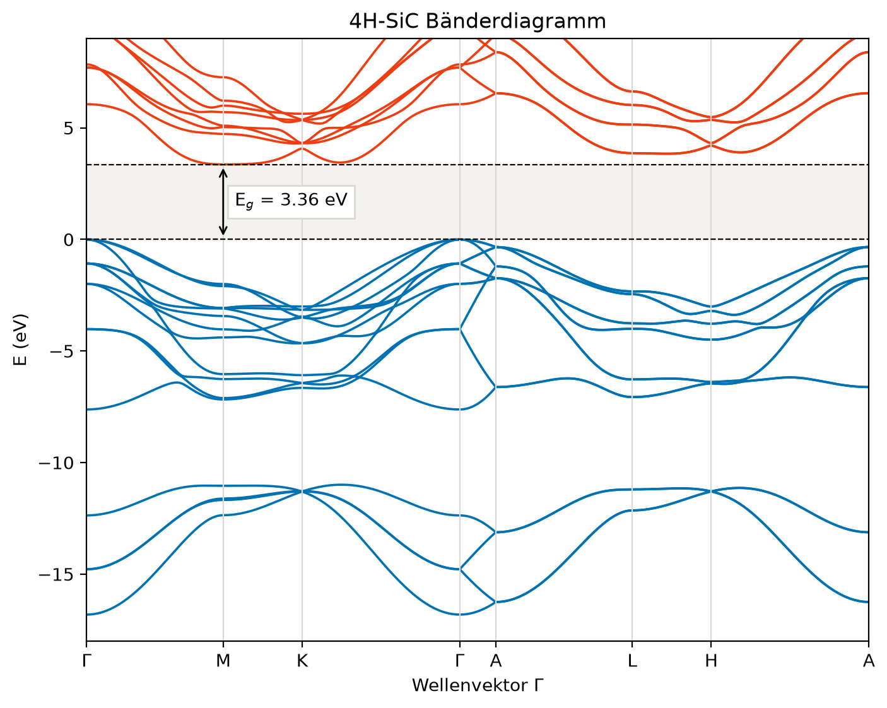

# BandGapProject

`xH-SiC.py` berechnet die elektronische Bandstruktur von xH-SiC mit einem empirischen sp³s\*-Tight-Binding-Modell und speichert sie als Diagramm ab.



## Inhalt

- [Installation und Aufruf](#installation-und-aufruf)
- [Physikalisches Modell](#physikalisches-modell)
- [Parameter und Konstanten](#parameter-und-konstanten)
- [Programmaufbau](#programmaufbau)
- [Ausgabe und Ergebnisse](#ausgabe-und-ergebnisse)
- [Anpassung und Erweiterung](#anpassung-und-erweiterung)
- [Grenzen des Modells](#grenzen-des-modells)

## Installation und Aufruf

**Voraussetzungen:** Python 3 mit `numpy` und `matplotlib`.

```bash
pip install numpy matplotlib
python3 sic_tb.py
```

Das Programm gibt die Bandlücke in der Konsole aus und schreibt `bandstruktur.png` in das aktuelle Verzeichnis. Die Laufzeit liegt bei etwa einer Sekunde.

```
Bandlücke E_g = 3.359 eV
```

## Physikalisches Modell

Das Programm nutzt ein sp³s\*-Tight-Binding-Modell (nach Vogl) mit Kopplungen nur zwischen nächsten Nachbarn. Die Kopplungsstärken skalieren nach Harrison mit 1/d².

### Kristallstruktur

4H-SiC ist hexagonal mit der Stapelfolge ABCB. Die Einheitszelle enthält 4 Si- und 4 C-Atome.

- **Gittervektoren:** a₁ = (a, 0, 0), a₂ = (−a/2, a·√3/2, 0), a₃ = (0, 0, c) mit a = 3,073 Å und c = 10,053 Å.
- **Si-Positionen (fraktionell):** (0, 0, 0), (1/3, 2/3, 1/4), (0, 0, 1/2), (2/3, 1/3, 3/4). Das entspricht der Folge A-B-A-C, die zu ABCB äquivalent ist.
- **C-Positionen:** jeweils um u·c entlang der c-Achse über dem Si-Atom, mit dem idealen Wert u = 3/16. Das ergibt eine axiale Bindungslänge von 1,885 Å.
- **Gitterplätze:** Die Schichten bei z = 0 und 1/2 sind kubisch (k), die bei z = 1/4 und 3/4 hexagonal (h).

### Basis und Hamiltonian

Jedes Atom trägt 5 Orbitale: s, pₓ, p_y, p_z und ein angeregtes s\*-Orbital. Bei 8 Atomen ist H(**k**) also eine 40×40-Matrix. Mit Bloch-Phasen über die Bindungsvektoren **d** lautet sie:

$$
H_{i\alpha,\,j\beta}(\mathbf{k}) = \varepsilon_{i\alpha}\,\delta_{ij}\delta_{\alpha\beta} + \sum_{\mathbf{d}} e^{i\mathbf{k}\cdot\mathbf{d}}\; t_{\alpha\beta}(\mathbf{d})
$$

Die Summe läuft über alle Bindungen von Atom i zu Atom j (auch in Nachbarzellen), deren Länge unter 2,3 Å liegt.

### Harrison-Skalierung

Jedes Hopping-Integral ergibt sich aus einem dimensionslosen Faktor η:

$$
V = \eta \, \frac{\hbar^2}{m_e\, d^2}, \qquad \frac{\hbar^2}{m_e} = 7{,}62\ \mathrm{eV\,\AA^2}
$$

### Slater-Koster-Elemente

Mit dem Richtungsvektor **l** = **d**/|**d**| baut `hamilton()` die 5×5-Blockmatrix t(**d**) so auf:

| Kopplung | Matrixelement |
| --- | --- |
| s–s | V_ss |
| s–p | ±lᵢ·V_sp. Das Vorzeichen hängt davon ab, welches Atom das s-Orbital trägt; unterschieden wird zwischen s(Si)–p(C) („ca“) und s(C)–p(Si) („ac“). |
| p–p | lᵢlⱼ·(V_ppσ − V_ppπ) + δᵢⱼ·V_ppπ |
| s\*–p | wie s–p, mit eigenen Faktoren für „ca“ und „ac“ |
| s\*–s, s\*–s\* | keine Kopplung (null) |

Diese Konstruktion erfüllt t(−**d**) von Atom j nach i = t(**d**)ᵀ. Damit ist H(**k**) hermitesch.

## Parameter und Konstanten

Alle Modellparameter stehen am Anfang der Datei und lassen sich dort direkt ändern.

| Name | Wert | Einheit | Bedeutung |
| --- | --- | --- | --- |
| `A` | 3,073 | Å | Gitterkonstante a (Basalebene) |
| `C` | 10,053 | Å | Gitterkonstante c (Stapelrichtung) |
| `U` | 3/16 | – | Abstand C über Si in Einheiten von c |
| `HBAR2_M` | 7,619964 | eV·Å² | ħ²/mₑ für die Harrison-Skalierung |
| `ONSITE["Si"]` | (−15,050; −5,020; 24,950) | eV | Orbitalenergien E_s, E_p, E_s\* von Si |
| `ONSITE["C"]` | (−16,020; −8,970; 23,980) | eV | Orbitalenergien E_s, E_p, E_s\* von C |
| `ETA["ss"]` | −1,57980 | – | η für s–s |
| `ETA["sp_ca"]` | 1,04569 | – | η für s(Si)–p(C) |
| `ETA["sp_ac"]` | 1,64281 | – | η für s(C)–p(Si) |
| `ETA["pps"]` | 2,70061 | – | η für ppσ |
| `ETA["ppp"]` | −0,48784 | – | η für ppπ |
| `ETA["s*p_ca"]` | 1,53756 | – | η für s\*(Si)–p(C) |
| `ETA["s*p_ac"]` | 4,18428 | – | η für s\*(C)–p(Si) |
| `NORB` | 5 | – | Orbitale pro Atom (s, pₓ, p_y, p_z, s\*) |
| `VALENCE` | Si: 4, C: 4 | Elektronen | Valenzelektronen pro Atom |
| `CATION` | {"Si"} | – | Atomsorte, die als Kation gilt |

Die Bindungslänge in SiC beträgt etwa 1,89 Å. Damit liegt V_ss bei etwa −1,58 · 7,62 / 1,89² ≈ −3,4 eV.

## Programmaufbau

Das Programm läuft in vier Schritten:

1. `bonds()` sucht alle Si–C-Nachbarpaare in der Einheitszelle und ihren 26 Nachbarzellen.
2. `Hamiltonian` legt die Onsite-Energien an und berechnet für jede Bindung einmal die Matrix t(**d**).
3. `band_structure()` diagonalisiert H(**k**) entlang des Pfads Γ–M–K–Γ–A–L–H–A und bestimmt die Bandkanten auf einem 3D-k-Netz.
4. `plot_bands()` zeichnet die Bänder relativ zum Valenzbandmaximum und speichert das Bild.

### `bonds(frac, cell, present, cutoff=2.3)`

Gibt eine Liste von Tupeln `(i, j, d)` zurück: Atom i, Atom j und den Bindungsvektor d in Å. Geprüft werden alle Atome j in der eigenen Zelle und in den Nachbarzellen mit Verschiebungen von −1, 0 oder +1 je Gitterrichtung. Eine Bindung zählt, wenn ihre Länge zwischen 0 und `cutoff` liegt. Jede Bindung erscheint dabei zweimal, einmal als i→j und einmal als j→i. `present` ist eine Maske, mit der man einzelne Atome ausblenden kann.

### `hamilton(si, sj, d)`

Gibt die 5×5-Hopping-Matrix t(**d**) zwischen Atomsorte `si` und `sj` zurück, mit Zeilen für die Orbitale von i und Spalten für die von j. Aus `si` wird bestimmt, ob die „ca“- oder die „ac“-Parameter auf das s-Orbital von i fallen.

### Klasse `Hamiltonian(frac, spec, cell, present=None)`

| Attribut / Methode | Inhalt |
| --- | --- |
| `n` | Größe der Matrix (5 × Anzahl Atome, hier 40) |
| `onsite` | Diagonale mit (E_s, E_p, E_p, E_p, E_s\*) je Atom |
| `B`, `T` | Bindungsliste und die zugehörigen t-Matrizen |
| `n_el` | Anzahl Valenzelektronen (hier 32) |
| `H(k)` | Bloch-Hamiltonian bei k (in 1/Å, kartesisch); bei k = 0 reell |
| `recip()` | reziproke Gittervektoren als Zeilen, 2π·(cell⁻¹)ᵀ |

### `band_structure(n_seg=60)`

Die Hochsymmetriepunkte stehen in `HSP` in fraktionellen reziproken Koordinaten und werden mit `recip()` in kartesische k umgerechnet. Jeder der 7 Pfadabschnitte bekommt `n_seg` Punkte; die x-Achse ist die echte Pfadlänge in 1/Å. VBM und LBM werden zusätzlich auf einem 12×12×6-Netz gesucht, damit die Bandlücke nicht vom gewählten Pfad abhängt. Die Anzahl der besetzten Bänder ist `n_el // 2` = 16.

**Rückgabe:** `x`, `E` (Energien pro k-Punkt und Band), `ticks` (Positionen der Hochsymmetriepunkte), `nocc`, `vbm`, `cbm`.

### `plot_bands(x, E, ticks, nocc, vbm, cbm, fn="bandstruktur.png")`

Verschiebt alle Energien so, dass das VBM bei 0 eV liegt. Besetzte Bänder werden blau gezeichnet, leere rot und die Bandlücke grau hinterlegt. Ein Pfeil mit Beschriftung zeigt E_g. Der Bildausschnitt reicht von −18 bis 9 eV, gespeichert wird mit 200 dpi.

### Hauptprogramm

Ruft `band_structure()` und `plot_bands()` auf und gibt die Bandlücke aus.

## Ausgabe und Ergebnisse

Das Modell liefert eine indirekte Bandlücke von 3,36 eV: Das Valenzbandmaximum liegt bei Γ, das Leitungsbandminimum bei M. Das entspricht dem bekannten Verhalten von 4H-SiC.

| k-Punkt | oberstes Valenzband (eV) | unterstes Leitungsband (eV) |
| --- | --- | --- |
| Γ | 0,00 (VBM) | 6,06 |
| M | −2,00 | 3,36 (LBM) |
| K | −3,01 | 4,07 |
| A | −0,34 | 6,55 |
| L | −2,33 | 3,86 |
| H | −3,01 | 4,20 |

Alle Energien sind relativ zum VBM angegeben. Das Valenzband ist insgesamt 16,8 eV breit.

**Diagramm `bandstruktur.png`:**

- Die blauen Kurven sind die 16 besetzten Valenzbänder, die roten die Leitungsbänder.
- Die gestrichelten Linien bei 0 eV und 3,36 eV markieren VBM und LBM.
- Der Pfeil mit Beschriftung sitzt an der Stelle des LBM auf dem Pfad, also bei M.
- Die Abschnitte Γ–A und A–L–H–A verlaufen entlang k_z bzw. in der Ebene k_z = π/c. Dort zeigt sich die Faltung der Bänder durch die 4H-Stapelfolge.

## Anpassung und Erweiterung

Die meisten Anpassungen sind Änderungen an Konstanten am Anfang der Datei.

| Ziel | Was ändern |
| --- | --- |
| Bandlücke oder Bandformen nachjustieren | `ONSITE` und `ETA` |
| Anderer Polytyp (z. B. 6H, 2H) | `SupCell` (c), `SI_FRAC` (Stapelfolge), `SPEC0` und `U` |
| Feinere Kurven | `n_seg` in `band_structure()` |
| Genauere Bandkanten | Netz `(12, 12, 6)` in `band_structure()` |
| Anderer k-Pfad | `HSP` und `PATH` |
| Bildausschnitt, Farben, Dateiname | `plot_bands()`: `set_ylim`, Farbcodes, `fn` |

Für einen anderen Polytyp muss außerdem die Anzahl der Atome stimmen: `SPEC0` braucht genau so viele Si- und C-Einträge, wie `FRAC0` Zeilen hat. Der Cutoff von 2,3 Å in `bonds()` funktioniert, solange die Si–C-Bindung bei etwa 1,9 Å und der Si–Si-Abstand bei etwa 3,1 Å liegt.

## Grenzen des Modells

- **Nur nächste Nachbarn:** Kopplungen zu weiter entfernten Atomen fehlen. Das begrenzt die Genauigkeit der Leitungsbänder.
- **Kein Spin-Bahn-Effekt:** Die Aufspaltung des Valenzbands bei Γ (in SiC nur etwa 10 meV) fehlt.
- **Ideale Geometrie:** Das Modell setzt u = 3/16 und ideale Tetraederwinkel voraus. Die kleinen Verzerrungen im realen Kristall fehlen.
- **Empirische Parameter:** Die Werte sind angepasst und nicht aus ersten Prinzipien berechnet. Ihre Herkunft sollte in einer Arbeit zitiert werden.
- **Keine Selbstkonsistenz:** Das Modell ist ein Einteilchenbild ohne Ladungsumverteilung. Es eignet sich deshalb nicht direkt für absolute Energien oder Defekte mit Relaxation.
